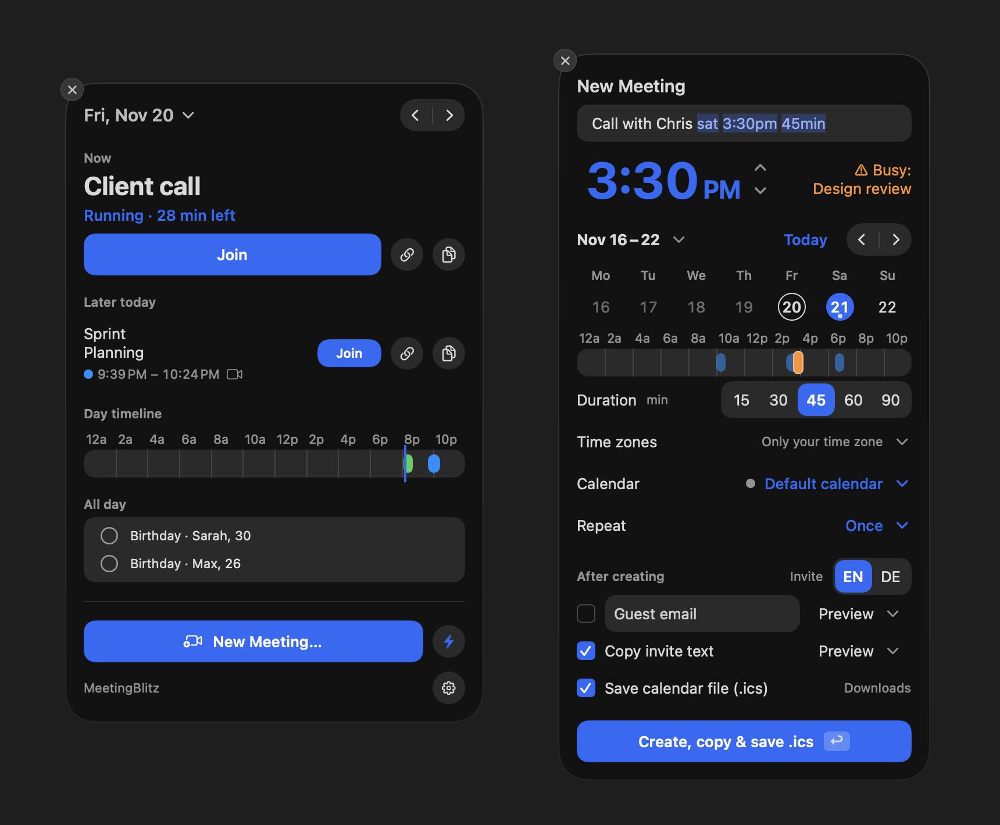
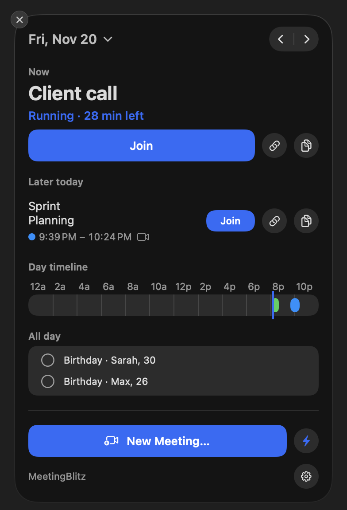
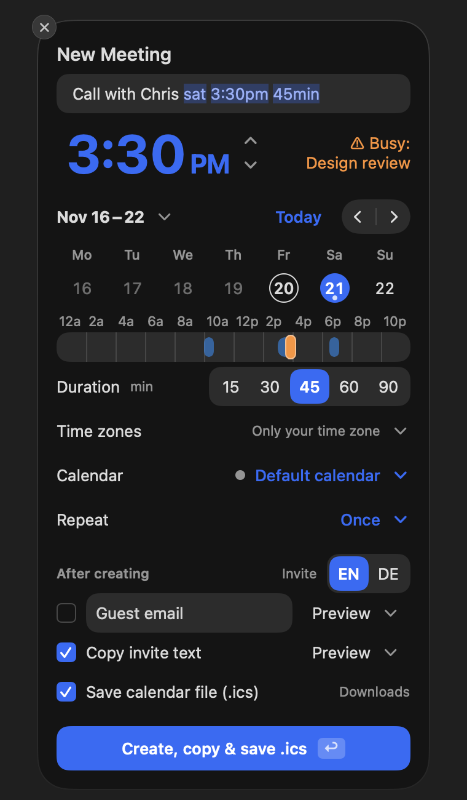
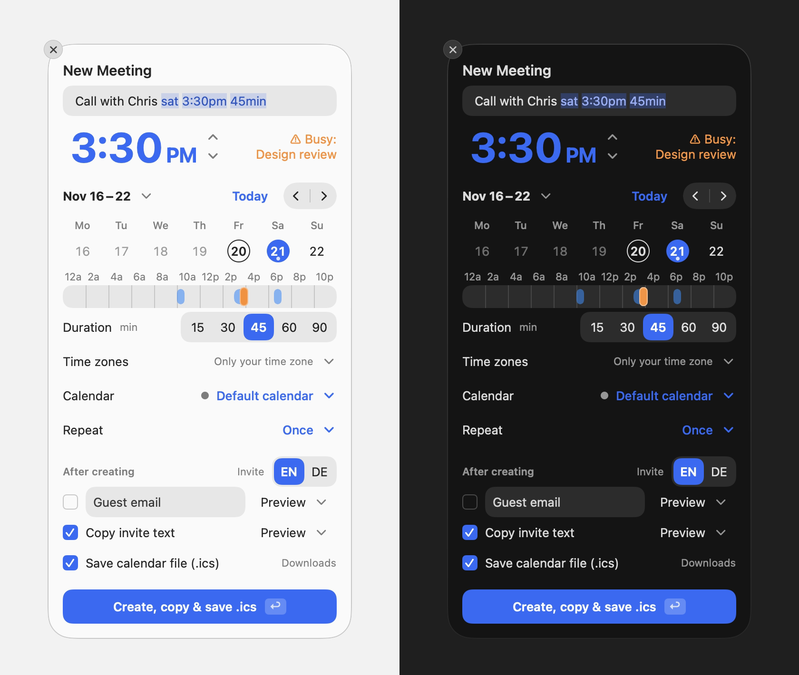

# MeetingBlitz

**Eine Mac-App in der Menüleiste, mit der du kein Meeting mehr verpasst.**
Ein paar Minuten vor jedem Termin fliegt ein Glas-Banner über alle deine
Bildschirme. Ein Klick darauf, und du bist im Call.

### ⬇ [MeetingBlitz 2.0 laden](https://github.com/Felixosk/meetingblitz-mac/releases/latest/download/MeetingBlitz.zip)

macOS 14+ · Apple Silicon und Intel · für private Nutzung kostenlos ·
[ein Befehl beim ersten Start](#möglichkeit-a-fertige-app-laden) ·
oder [selbst bauen](#möglichkeit-b-selbst-bauen) in zwei Minuten

[**Webseite**](https://felixosk.github.io/meetingblitz-mac/) ·
[Neu in 2.0](CHANGELOG.md) ·
[English version](README.md)

[](https://github.com/Felixosk/meetingblitz-mac/actions/workflows/build.yml)



## Was sie macht

**1. Ein Banner vor jedem Meeting.** Eine Glasleiste fliegt über jeden
Bildschirm, mit Titel, Uhrzeit und Beitreten-Knopf. Die übersieht man nicht. Fangen zwei Meetings gleichzeitig an, kommen zwei Banner
übereinander. "Nicht stören" schluckt es nicht, weil die App es selbst zeichnet.


**2. Dein Tag mit einem Klick.** Klick auf das Symbol in der Menüleiste und du
siehst heute: eine Zeitleiste von 0 bis 24 Uhr, das nächste Meeting, Geburtstage
mit Anruf-Knopf, und bei jedem Termin: beitreten, kopieren, exportieren oder
ausblenden. Mit den Pfeilen springst du in jede Woche und jeden Monat.



**3. Ein Meeting in einer Zeile.** Schreib `call with chris fri 4pm 45min` und
das Fenster liest Tag, Uhrzeit und Länge heraus, während du tippst. Darunter
zeigt eine Tageszeile, was sonst noch ansteht, und du kannst das neue Meeting
darin verschieben. Ist die Zeit schon belegt, sagt es dir das vor dem Buchen.



**4. Nach dem Erstellen macht sie den Rest.** Unter dem Feld wählst du, was
danach passiert: Einladung per Mail an bis zu 5 Gäste (über dein Gmail), Details
kopieren, Kalenderdatei speichern. Der Knopf sagt, was er tun wird. Den Mailtext
kannst du für dieses eine Meeting ändern, bevor er rausgeht.

**5. Sofort-Meeting.** Der Blitz-Knopf macht sofort einen Google-Meet-Raum,
trägt ihn in deinen Google-Kalender ein und öffnet den Call. 5 Sekunden lang
kannst du es rückgängig machen, dann ist der Termin wieder weg.

### Hell oder dunkel, wie du willst

Die App folgt deinem Mac, oder du stellst Hell oder Dunkel selbst ein
(**Einstellungen → Allgemein → Aussehen**). Für unruhige Hintergründe lässt sich
das Glas klarer stellen.



## Alle Funktionen

- **Banner vor jedem Termin** auf allen Bildschirmen, Vorlauf frei wählbar, überlappende Termine bekommen jeder ein eigenes
- **27 Motive** für das Flugobjekt: U-Boot, Wal, Jet, UFO und mehr, in 3 Stilen. Doppelklick zeigt die echte Geschichte dahinter, mit Quelle
- **Widget in der Menüleiste** mit Zeitleiste, Wochen- und Monatsansicht, jeder Tag einen Klick entfernt
- **Beitreten mit einem Klick** bei 53 Diensten: Meet, Zoom, Teams, Webex, Whereby, Jitsi, Discord, Slack Huddles, GoTo und mehr
- **Neues Meeting in einer Zeile**, mit Tageszeile zum Verschieben und Warnung, wenn die Zeit belegt ist
- **Mail an Gäste** (optional, über dein eigenes Gmail): bis zu 5 Gäste, eine Mail an alle, Text pro Meeting änderbar, Vorlage auf Deutsch oder Englisch
- **Sofort-Meeting** mit Google-Meet-Link und 5 Sekunden zum Rückgängigmachen
- **Zeitzonen** im Fenster für neue Meetings: Städte dazunehmen, umbenennen, Uhrzeit für jede sehen
- **Termin kopieren** als Datei und Text zugleich: in WhatsApp eingefügt wird ein Anhang daraus, in einem Textfeld Text
- **Apple Erinnerungen**, die heute fällig sind, stehen neben deinen Terminen
- **Pro Kalender** bestimmst du, was angezeigt wird, was ein Banner auslöst und ob Geburtstage erscheinen
- **Abgelehnte Einladungen warnen nie**. Sie bleiben sichtbar, durchgestrichen
- **Ruhe-Modus**, befristet (1 h, 5 h, 1 Tag, 1 Woche) und automatisch, während du deinen Bildschirm teilst
- **Zwei Tastenkürzel**, beide änderbar: Widget öffnen, laufendem oder nächstem Call beitreten
- **Meeting-Statistik** für Woche, Monat und Jahr
- **Automatisierung** über `meetingblitz://show`, `join-next`, `instant`, `create?text=…`, `settings`
- **Claude verwaltet deinen Kalender** (optional, standardmäßig aus), [Details unten](#optional-claude-verwaltet-deinen-kalender)
- **Deutsch und Englisch**, jederzeit umschaltbar

Natives Swift und SwiftUI. Kein Electron, kein Server, kein Konto, kein Tracking.

## Im Vergleich

| | MeetingBlitz | [MeetingBar](https://github.com/leits/MeetingBar) | [Itsycal](https://github.com/sfsam/Itsycal) | [Calendr](https://github.com/pakerwreah/Calendr) |
|---|---|---|---|---|
| Überlappende Termine warnen **einzeln** | **ja** | nein ([offen seit 2021](https://github.com/leits/MeetingBar/issues/271)) | – | – |
| Art der Warnung | Banner über **alle** Bildschirme | Titel in der Menüleiste, Mitteilung, optional Vollbild | keine | keine |
| Warnung bei Überschneidung beim Anlegen | **ja** | nein | nein | nein |
| Erkennung von Meeting-Links | 53 Dienste | 50+ Dienste | keine | einfach |
| Neuer Termin in einer Zeile | ja | nein | nein | ja |
| Einladung per Mail an Gäste | ja, über dein Gmail | nein | nein | nein |
| Zeitzonen | ja, im Fenster für neue Meetings | nein | nein | ja |
| Zugriff für Claude / MCP | ja, optional | nein | nein | nein |
| Apple Erinnerungen in derselben Liste | ja | nein | ja | ja |
| Kalenderquellen | Apple Kalender (iCloud, Google, Exchange über macOS) | Apple Kalender + Google direkt | Apple Kalender | Apple Kalender |
| Reife | Hobbyprojekt | 5,3k Sterne, jahrelang poliert | 4,0k Sterne | 2,3k Sterne |

Wenn du die ausgereifteste App mit den meisten Diensten willst, nimm MeetingBar.
Die ist sehr gut, und dieses Projekt hat als Fan davon angefangen.

## Voraussetzungen

- **macOS 14 (Sonoma) oder neuer**. Am schönsten sieht das Glas auf macOS 26 aus
- Apple Silicon oder Intel (Universal-App)
- **Xcode Command Line Tools**, wenn du selbst baust

## Installation

### Möglichkeit A: fertige App laden

Lade `MeetingBlitz.zip` aus dem [neuesten Release](https://github.com/Felixosk/meetingblitz-mac/releases/latest),
entpacke es und zieh **MeetingBlitz.app** in den Ordner **Programme**.

Die App ist mit einem selbst erstellten Zertifikat signiert, nicht mit einem
bezahlten Apple-Entwicklerkonto. Darum stellt macOS sie nach dem Laden unter
Quarantäne. Ein Befehl hebt das auf:

```bash
xattr -dr com.apple.quarantine /Applications/MeetingBlitz.app
```

Danach ganz normal öffnen. Der Befehl sagt macOS, dass du selbst für die App
bürgst, und überspringt die Gatekeeper-Prüfung. Mach das nur bei Software, der
du vertraust. Du kannst hier vorher jede Zeile des Codes lesen oder Möglichkeit B
nehmen.

Ohne den Befehl geht es auch auf dem langen Weg: Doppelklick, bei der Warnung
**Fertig** klicken, dann **Systemeinstellungen → Datenschutz & Sicherheit →
Trotzdem öffnen** und noch einmal bestätigen.

### Möglichkeit B: selbst bauen

Zwei Minuten und gar keine Gatekeeper-Warnung, weil selbst gebaute Software
nicht unter Quarantäne steht.

```bash
git clone https://github.com/Felixosk/meetingblitz-mac.git
cd meetingblitz-mac
./build.sh && open dist/MeetingBlitz.app
```

Fehlen die Command Line Tools, installiert dieser Befehl sie einmalig (ein paar
hundert MB). Danach noch einmal bauen:

```bash
xcode-select --install
```

Beim ersten Start führt dich eine kurze Begrüßung durch Kalenderzugriff, die
Wahl der Kalender und den Start bei der Anmeldung. Du kannst sie jederzeit unter
**Einstellungen → Erweitert → Einführung** wiederholen.

### Wichtig zu wissen

**Die App hat kein Fenster und kein Symbol im Dock.** Sie sitzt oben rechts in
der Menüleiste. Wenn nach dem Start scheinbar nichts passiert, schau dort.

### Falls du eine fertig gebaute App bekommen hast

Gatekeeper blockiert sie, weil sie nicht mit einem bezahlten Apple-Entwicklerkonto
signiert ist. Auf aktuellem macOS:

1. Zieh die App vor dem ersten Start in **Programme**. Sonst läuft sie aus einem
   vorläufigen, schreibgeschützten Ordner und "Bei Anmeldung öffnen" klappt nicht
   zuverlässig.
2. Doppelklick. Im Fenster "Apple konnte nicht überprüfen…" auf **Fertig**
   klicken. Nie "In den Papierkorb legen".
3.  → **Systemeinstellungen** → **Datenschutz & Sicherheit**, ganz nach unten
   zu **Sicherheit**. Dort steht jetzt "MeetingBlitz wurde blockiert" mit dem
   Knopf **Trotzdem öffnen**.
4. Noch einmal doppelklicken und **Öffnen** bestätigen.

Schritt 3 bald nach Schritt 2 machen, sonst verschwindet der Knopf und du fängst
bei Schritt 2 wieder an. Danach ist die App dauerhaft freigegeben. Der alte Trick
Rechtsklick → Öffnen geht seit macOS 15 nicht mehr.

Nur wenn dort "ist beschädigt und kann nicht geöffnet werden" steht:

```bash
xattr -cr "/Applications/MeetingBlitz.app"
```

## Optional: Meetings mit Google-Meet-Link anlegen

Alles oben geht auch ohne das. Der Knopf **Sofort-Meeting**, der Meet-Link bei
neuen Terminen und die Mail an Gäste reden für dich mit Google. Dafür brauchst
du eigene Zugangsdaten. Es gibt keinen gemeinsamen App-Schlüssel, und in diesem
Repo liegt keiner.

Einmalig, etwa zehn Minuten:

1. Öffne die [Google Cloud Console](https://console.cloud.google.com/) und lege
   ein Projekt an (Name egal).
2. **APIs & Dienste → Bibliothek**: **Google Calendar API** aktivieren.
3. **APIs & Dienste → OAuth-Zustimmungsbildschirm**: **Extern** wählen, App-Name
   und deine Mail eintragen. Unter **Zielgruppe** deine eigene Google-Adresse als
   Testnutzer eintragen. (Mit einem Workspace-Konto stattdessen Intern wählen,
   dann läuft die Anmeldung nicht alle 7 Tage ab.)
4. **APIs & Dienste → Anmeldedaten → Anmeldedaten erstellen → OAuth-Client-ID**,
   Typ **Desktop-App**. JSON herunterladen.
5. Leg die Datei hierhin (Ordner wird bei Bedarf angelegt):

```bash
mkdir -p ~/Library/Application\ Support/MeetingBlitz
cp ~/Downloads/client_secret_*.json ~/Library/Application\ Support/MeetingBlitz/google-oauth.json
```

6. MeetingBlitz neu starten. Unter **Einstellungen → Meetings** steht jetzt
   **Mit Google verbinden**. Einmal anmelden. Der Schlüssel liegt danach im
   macOS-Schlüsselbund, nie in einer Datei.

Ohne diese JSON-Datei bleiben die Google-Teile ausgeblendet und kein Google-Code
läuft.

**Ablauf nach 7 Tagen:** Solange der OAuth-Client im Modus *Test* ist, beendet
Google die Anmeldung nach einer Woche und du musst neu verbinden. Der Knopf
**Veröffentlichen** auf dem Zustimmungsbildschirm (oder eine interne
Workspace-Zielgruppe) beendet das.

### Optional: Einladung per Mail an Gäste (Gmail)

Standardmäßig aus. Schalte **Einstellungen → Meetings → Mail an Gäste** ein, dann
bekommt das Fenster für neue Meetings ein Gast-Feld (bis zu 5 Adressen, eine Mail
an alle). MeetingBlitz schickt eine einfache Mail von deinem verbundenen
Google-Konto über die Gmail API, auf Wunsch mit Kalenderdatei im Anhang. Die App
kann nur senden, nicht lesen.

Einmalig im Google-Cloud-Projekt:

1. **APIs & Dienste → Bibliothek**: **Gmail API** aktivieren.
2. **OAuth-Zustimmungsbildschirm → Datenzugriff**: den Bereich
   `https://www.googleapis.com/auth/gmail.send` hinzufügen.
3. In MeetingBlitz **Google neu verbinden** klicken und im Browser "E-Mails
   senden" anhaken. Die App fragt nur danach, wenn der Schalter an ist.

Gast-Adressen werden nie gespeichert und nie in ein Protokoll geschrieben. Für
den Mailtext gibt es eine deutsche und eine englische Vorlage mit den Platzhaltern
`{title} {date} {time} {times} {duration} {link}`. Im Fenster für neue Meetings
kannst du den Text für ein einzelnes Meeting ändern, ohne die Vorlage anzufassen.

## Optional: Claude verwaltet deinen Kalender

MeetingBlitz kann als MCP-Server für [Claude Code](https://claude.com/claude-code)
und Claude Desktop laufen. Dann sagst du "verschieb meinen Call um 14 Uhr auf 16
Uhr" oder "trag Donnerstag um 10 Uhr Berliner Zeit einen Call mit Anna ein", und
Claude macht das über die App.

Standardmäßig aus. So geht es:

1. **Einstellungen → Erweitert → Claude-Zugang (MCP)**: einschalten.
2. **Befehl kopieren** klicken, in ein Terminal einfügen und einmal ausführen. Er
   ruft `claude mcp add` mit dem Pfad zu deiner App auf.
3. Einen neuen Claude-Chat öffnen. Die Werkzeuge sind da.

Was Claude kann:

- `get_context`: Zeitzone deines Macs und die aktuelle Uhrzeit. Zeiten ohne Zone
  gelten in dieser Zone. Keine IP-Abfrage, ein VPN kann es also nicht täuschen.
- `list_calendars`, `list_events`: Kalender und Termine lesen.
- `create_event`: neuer Termin mit Zeitzone. Meet-Link nur, wenn du ihn willst.
- `move_event`: verschiebt einen Termin und behält die Länge. Bei Serien nur
  dieser eine Tag. Hat dich jemand anderes eingeladen, kommt ein Fehler, weil die
  Änderung die anderen nie erreichen würde.
- `delete_event`: nur Termine, die Claude selbst angelegt hat.

Die App öffnet eine Brücke auf `127.0.0.1`, die für jede Anfrage einen Schlüssel
braucht. Ohne Schlüssel kommt 401. Von außerhalb deines Macs ist nichts
erreichbar.

## Berechtigungen und Datenschutz

Beim ersten Start fragt die App nach **Kalenderzugriff**, optional nach
**Erinnerungen**. Beides bleibt auf deinem Mac. Es gibt keinen Server, keine
Telemetrie und kein Konto. Der Code liegt hier.

Der Google-Teil läuft nur, wenn du deine eigene OAuth-Datei hinlegst. In diesem
Repo stecken keine Zugangsdaten. Der Claude-Zugang ist aus, bis du ihn
einschaltest, und hört dann nur auf `127.0.0.1`.

## Wenn etwas klemmt

**Das Symbol in der Menüleiste fehlt.** Rechts von der Kerbe ist wenig Platz
(etwa 790 Punkte auf einem MacBook, für alle Apps zusammen). Ist er voll, lässt
macOS Symbole ohne Meldung weg. Andere Menüleisten-Apps beenden oder das Widget
mit **⌃⌥M** öffnen.

**Die App sieht keine Termine.** Systemeinstellungen → Datenschutz & Sicherheit →
Kalender → MeetingBlitz einschalten. macOS bietet dort auch "Nur hinzufügen" an.
Damit darf die App schreiben, sieht aber nichts. Sie braucht vollen Zugriff.

**Google fragt immer wieder.** Nach einem Update fragt macOS einmal, ob
MeetingBlitz seinen Schlüsselbund-Eintrag benutzen darf. **Immer erlauben**
klicken, sonst wartet die Google-Anmeldung.

**Statusbericht.** Rechtsklick auf das Symbol in der Menüleiste → "Diagnose
speichern". Der Bericht landet in `~/Downloads` und listet Version,
Berechtigungen, Bildschirme und Fensterpositionen als Text. Er enthält deine
Kalendernamen, also vor dem Weitergeben durchlesen.

## Mit Claude Code daran arbeiten

`CLAUDE.md` in diesem Repo beschreibt Aufbau, Build und die Stolperfallen. Öffne
Claude Code in diesem Ordner und sag, was du geändert haben willst.

## Signieren

Ohne Einstellung signiert `build.sh` ad hoc. Dann **verwirft macOS bei jedem
Neubau deine erteilten Berechtigungen**, weil es eine neue App sieht. Wenn du oft
baust, leg ein selbst signiertes Zertifikat an und kopiere
`signing.local.example` nach `signing.local`. Die Schritte stehen in der Datei.

## Lizenz

PolyForm Strict 1.0.0. Private und andere nicht kommerzielle Nutzung ist erlaubt. Code ändern, darauf aufbauen und weitergeben ist nicht erlaubt. Siehe [LICENSE](LICENSE).
