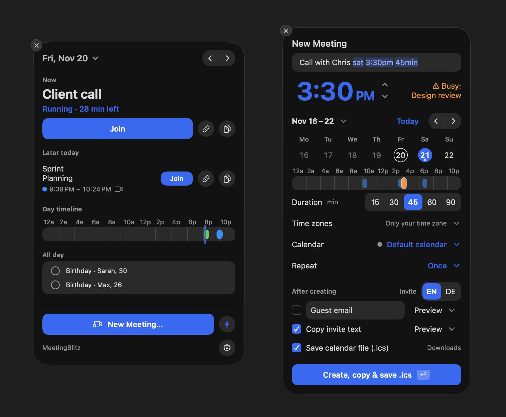
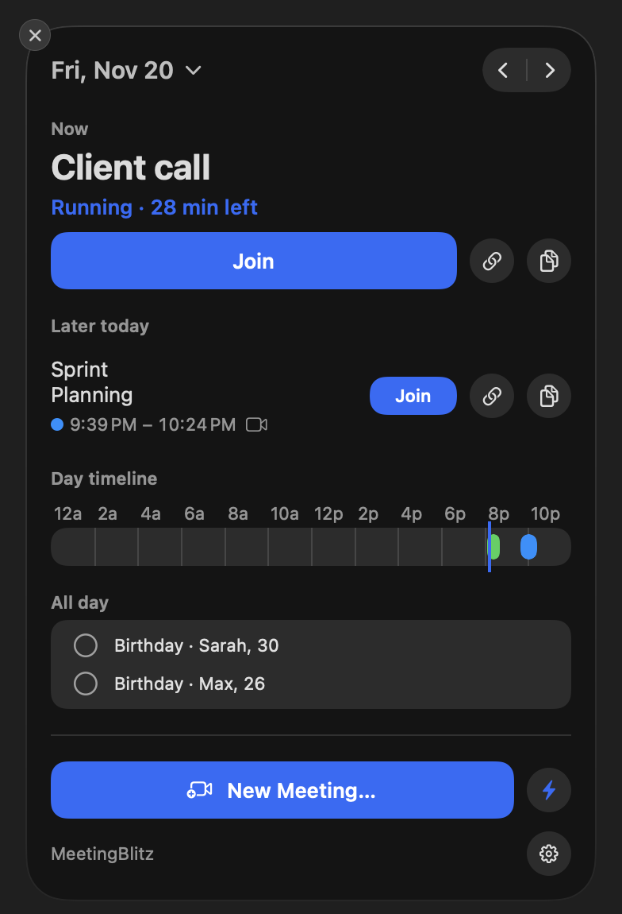
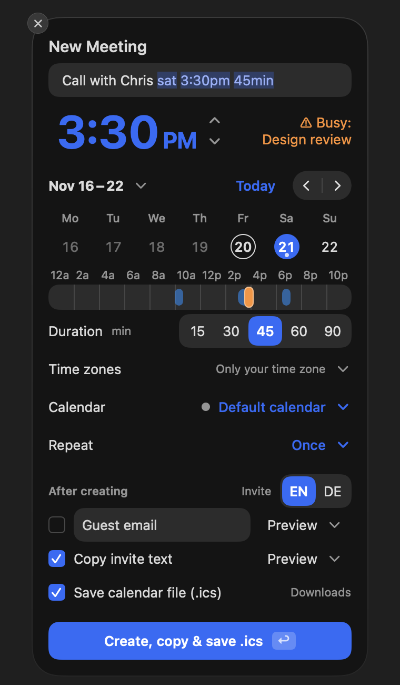
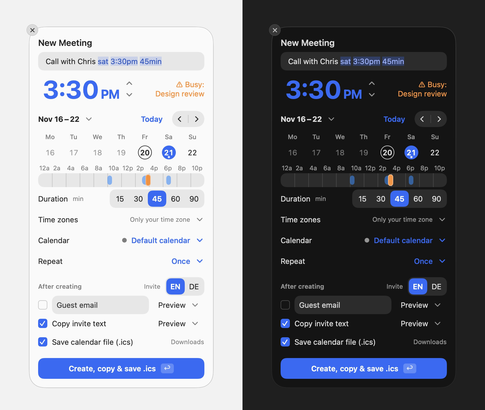

# MeetingBlitz

**A Mac menu bar app that makes sure you never miss a meeting.** A few minutes
before each event a glass banner flies across all your screens. One click on it
and you are in the call.

### ⬇ [Download MeetingBlitz 2.0](https://github.com/Felixosk/meetingblitz-mac/releases/latest/download/MeetingBlitz.zip)

macOS 14+ · Apple Silicon and Intel · free for personal use ·
[one extra command on first launch](#option-a-download-the-ready-made-app) ·
or [build it yourself](#option-b-build-it-yourself) in two minutes

[**Website**](https://felixosk.github.io/meetingblitz-mac/) ·
[What's new in 2.0](CHANGELOG.md) ·
[Deutsche Version](README.de.md)

[](https://github.com/Felixosk/meetingblitz-mac/actions/workflows/build.yml)



## What it does

**1. A banner before every meeting.** A glass bar flies across every monitor,
with the title, the time and a Join button. It is hard to miss. If two meetings
start at the same time, you get two banners, one above the other. Do Not Disturb
does not swallow it, because the app draws it itself.


**2. Your day in one click.** Click the icon in the menu bar and you see today:
a timeline from 0 to 24, the next meeting, birthdays with a call button, and
for every event: join, copy, export or hide. Step to any week or month with the
arrows.



**3. Type a meeting in one line.** Write `call with chris fri 4pm 45min` and the
window picks out the day, the time and the length while you type. A day strip
underneath shows what else is on, and you can drag the new meeting around in it.
If the slot is taken, it tells you before you book it.



**4. After creating, it does the rest.** Below the field you choose what happens
next: send the invite by email to up to 5 guests (through your Gmail), copy the
details, save a calendar file. The button says what it will do. You can edit
the email text for this one meeting before it goes out.

**5. Instant meeting.** The lightning button makes a Google Meet room right now,
puts it in your Google calendar and opens the call. For 5 seconds you can undo
it, and the event is gone again.

### Light or dark, your choice

The app follows your Mac, or you pick Light or Dark yourself
(**Settings → General → Appearance**). The glass can be made clearer for
busy wallpapers.



## All features

- **Banner before every event** on all monitors, lead time of your choice, overlapping events each get their own
- **27 motifs** for the flying object: submarine, whale, jet, UFO and more, in 3 styles. Double-click one to read its real story, with a source
- **Widget in the menu bar** with a timeline, week and month view, and any day one click away
- **One-click join** for 53 services: Meet, Zoom, Teams, Webex, Whereby, Jitsi, Discord, Slack huddles, GoTo and more
- **New meeting in one line**, with a day strip you can drag the meeting in, and a warning when the slot is taken
- **Email to guests** (optional, through your own Gmail): up to 5 guests, one mail to all, text editable per meeting, English or German template
- **Instant meeting** with a Google Meet link and 5 seconds to undo
- **Time zones** in the New Meeting window: add cities, rename them, see the time for each
- **Copy an event** as a file and text at once: paste it into WhatsApp and it becomes an attachment, paste it into a text field and it becomes text
- **Apple Reminders** due today show up next to your events
- **Per calendar** you choose what shows, what fires a banner, and whether its birthdays appear
- **Declined invitations never warn you**. They stay visible, struck through
- **Quiet mode**, timed (1h, 5h, 1 day, 1 week) and automatically while you share your screen
- **Two global shortcuts**, both rebindable: open the widget, join the current or next call
- **Meeting stats** for the week, month and year
- **Automation** via `meetingblitz://show`, `join-next`, `instant`, `create?text=…`, `settings`
- **Claude can manage your calendar** (optional, off by default), [details below](#optional-let-claude-manage-your-calendar)
- **English and German**, switch any time

Native Swift and SwiftUI. No Electron, no server, no account, no tracking.

## How it compares

| | MeetingBlitz | [MeetingBar](https://github.com/leits/MeetingBar) | [Itsycal](https://github.com/sfsam/Itsycal) | [Calendr](https://github.com/pakerwreah/Calendr) |
|---|---|---|---|---|
| Overlapping events warn **one by one** | **yes** | no ([open since 2021](https://github.com/leits/MeetingBar/issues/271)) | n/a | n/a |
| Warning style | banner across **all** screens | menu bar title, notification, optional fullscreen | none | none |
| Conflict warning while creating | **yes** | no | no | no |
| Meeting link detection | 53 services | 50+ services | none | basic |
| New event in one line | yes | no | no | yes |
| Email invite to guests | yes, via your Gmail | no | no | no |
| Time zones | yes, in the New Meeting window | no | no | yes |
| Claude / MCP access | yes, optional | no | no | no |
| Apple Reminders in the same list | yes | no | yes | yes |
| Calendar sources | Apple Calendar (iCloud, Google, Exchange through macOS) | Apple Calendar + Google directly | Apple Calendar | Apple Calendar |
| Maturity | hobby project | 5.3k stars, years of polish | 4.0k stars | 2.3k stars |

If you want the most mature option with the widest service coverage, install
MeetingBar. It is excellent, and this project started as a fan of it.

## Requirements

- **macOS 14 (Sonoma) or newer**. The glass look is sharpest on macOS 26
- Apple Silicon or Intel (universal binary)
- **Xcode Command Line Tools** if you build it yourself

## Install

### Option A: download the ready-made app

Get `MeetingBlitz.zip` from the [latest release](https://github.com/Felixosk/meetingblitz-mac/releases/latest),
unzip it, and move **MeetingBlitz.app** into your **Applications** folder.

The app is signed with a self-made certificate, not with a paid Apple developer
account, so macOS quarantines it on download. One command clears that flag:

```bash
xattr -dr com.apple.quarantine /Applications/MeetingBlitz.app
```

Then open it normally. This command tells macOS that you vouch for the app
yourself and skips the Gatekeeper check. Only run it on software you trust.
You can read every line of the source here first, or take option B.

Without the command you can still open it the long way: double-click, click
**Done** on the warning, then **System Settings → Privacy & Security → Open
Anyway**, and confirm once more.

### Option B: build it yourself

Two minutes, and no Gatekeeper warning at all, because software you compile
yourself is not quarantined.

```bash
git clone https://github.com/Felixosk/meetingblitz-mac.git
cd meetingblitz-mac
./build.sh && open dist/MeetingBlitz.app
```

If the Command Line Tools are missing, this installs them once (a few hundred
MB), then build again:

```bash
xcode-select --install
```

On first launch a short welcome covers calendar access, which calendars to show
and launch at login. You can replay it any time under
**Settings → Advanced → Walkthrough**.

### Good to know

**The app has no window and no Dock icon.** It lives in the menu bar, top
right. If nothing seems to happen after launch, look up there.

### If you were handed a prebuilt app

Gatekeeper blocks it, because it is not signed by a paid Apple developer
account. On current macOS:

1. Drag the app into **Applications** before the first launch. Otherwise it runs
   from a temporary read-only folder and "launch at login" is unreliable.
2. Double-click. In the "Apple could not verify…" dialog click **Done**. Never
   "Move to Trash".
3.  → **System Settings** → **Privacy & Security**, scroll down to
   **Security**. It now says "MeetingBlitz was blocked" with an
   **Open Anyway** button.
4. Double-click again and confirm **Open**.

Do step 3 soon after step 2, otherwise the button disappears and you start over
at step 2. After that the app is cleared for good. The old right-click → Open
trick no longer works since macOS 15.

Only if it says "damaged and can't be opened":

```bash
xattr -cr "/Applications/MeetingBlitz.app"
```

## Optional: create meetings with a Google Meet link

Everything above works without this. The **Instant meeting** button, the Meet
link on new events and the email to guests talk to Google for you, so they need
credentials that belong to you. There is no shared app key, and none ships in
this repo.

It is a ten-minute, one-time setup:

1. Open the [Google Cloud Console](https://console.cloud.google.com/) and create
   a project (any name).
2. **APIs & Services → Library**: enable the **Google Calendar API**.
3. **APIs & Services → OAuth consent screen**: pick **External**, fill in the
   app name and your email. Under **Audience**, add your own Google address as a
   test user. (With a Workspace account choose Internal instead, then tokens
   don't expire every 7 days.)
4. **APIs & Services → Credentials → Create credentials → OAuth client ID**,
   type **Desktop app**. Download the JSON.
5. Put that file here, creating the folder if needed:

```bash
mkdir -p ~/Library/Application\ Support/MeetingBlitz
cp ~/Downloads/client_secret_*.json ~/Library/Application\ Support/MeetingBlitz/google-oauth.json
```

6. Restart MeetingBlitz. **Settings → Meetings** now offers **Connect Google**.
   Sign in once. The token is stored in your macOS Keychain, never in a file.

Without that JSON the Google parts stay hidden and no Google code runs.

**The 7-day expiry:** while the OAuth client is in *Testing* mode, Google ends
the sign-in after a week and you have to reconnect. The consent screen's
**Publish** button (or an Internal Workspace audience) stops that.

### Optional: email the invite to guests (Gmail)

Off by default. Switch on **Settings → Meetings → Email to guests** and the New
Meeting window gets a guest field (up to 5 addresses, one mail to all).
MeetingBlitz sends a plain mail from your connected Google account through the
Gmail API, with the calendar file attached if you like. It can only send, not
read.

One-time setup in your Google Cloud project:

1. **APIs & Services → Library**: enable the **Gmail API**.
2. **OAuth consent screen → Data access**: add the scope
   `https://www.googleapis.com/auth/gmail.send`.
3. In MeetingBlitz click **Reconnect Google** and tick "Send email" in the
   browser. The app only asks for this when the switch is on.

Guest addresses are never stored and never written to a log. The mail text has
an English and a German template, with the placeholders
`{title} {date} {time} {times} {duration} {link}`. In the New Meeting window you
can change the text for one meeting without touching the template.

## Optional: let Claude manage your calendar

MeetingBlitz can act as an MCP server for [Claude Code](https://claude.com/claude-code)
and Claude Desktop. Then you say "move my 2 pm call to 4 pm" or "put a call with
Anna on Thursday at 10 Berlin time" and Claude does it through the app.

It is off by default. To use it:

1. **Settings → Advanced → Claude access (MCP)**: switch it on.
2. Click **Copy command**, paste it into a terminal and run it once. It runs
   `claude mcp add` with the path to your copy of the app.
3. Open a new Claude chat. The tools are there.

What Claude can do:

- `get_context`: your Mac's time zone and the current time. Times without a zone
  count in that zone. No IP lookup, so a VPN cannot fool it.
- `list_calendars`, `list_events`: read your calendars and events.
- `create_event`: new event with a time zone. A Meet link only if you ask.
- `move_event`: moves one event and keeps its length. In a recurring series only
  that one day moves. If someone else invited you, you get an error, because the
  change would never reach the others.
- `delete_event`: only events Claude created itself.

The app opens a bridge on `127.0.0.1` that needs a token for every request.
Without the token you get a 401. Nothing is reachable from outside your Mac.

## Permissions and privacy

The app asks for **calendar access** on first launch, and optionally for
**reminders**. Both stay on your Mac. There is no server, no telemetry and no
account. The source is right here.

The Google part only runs if you add your own OAuth file. No credentials are in
this repository. Claude access is off until you switch it on, and then it only
listens on `127.0.0.1`.

## Troubleshooting

**The menu bar icon is missing.** Space right of the notch is limited (about
790 points on a MacBook, shared by all apps). When it is full, macOS drops icons
without any message. Quit other menu bar apps, or open the widget with
**⌃⌥M**.

**The app sees no events.** System Settings → Privacy & Security → Calendars →
enable MeetingBlitz. macOS also offers "add only" there. With that the app may
write but sees nothing. It needs full access.

**Google keeps asking.** After an update macOS asks once whether MeetingBlitz
may use its Keychain item. Click **Always Allow**, otherwise the Google sign-in
waits.

**Status report.** Right-click the menu bar icon → "Save diagnostics". The
report lands in `~/Downloads` and lists version, permissions, screens and
window positions in plain text. It contains your calendar names, so read it
before you share it.

## Working on it with Claude Code

`CLAUDE.md` in this repository describes the architecture, the build and the
traps. Open Claude Code in this folder and tell it what you want changed.

## Signing

Without config `build.sh` signs ad-hoc. Then **macOS drops your granted
permissions on every rebuild**, because it sees a new app. If you build often,
create a self-signed certificate and copy `signing.local.example` to
`signing.local`. The steps are in that file.

## License

PolyForm Strict 1.0.0. Personal and other noncommercial use is allowed. Changing the code, building on it and passing it on are not allowed. See [LICENSE](LICENSE).
